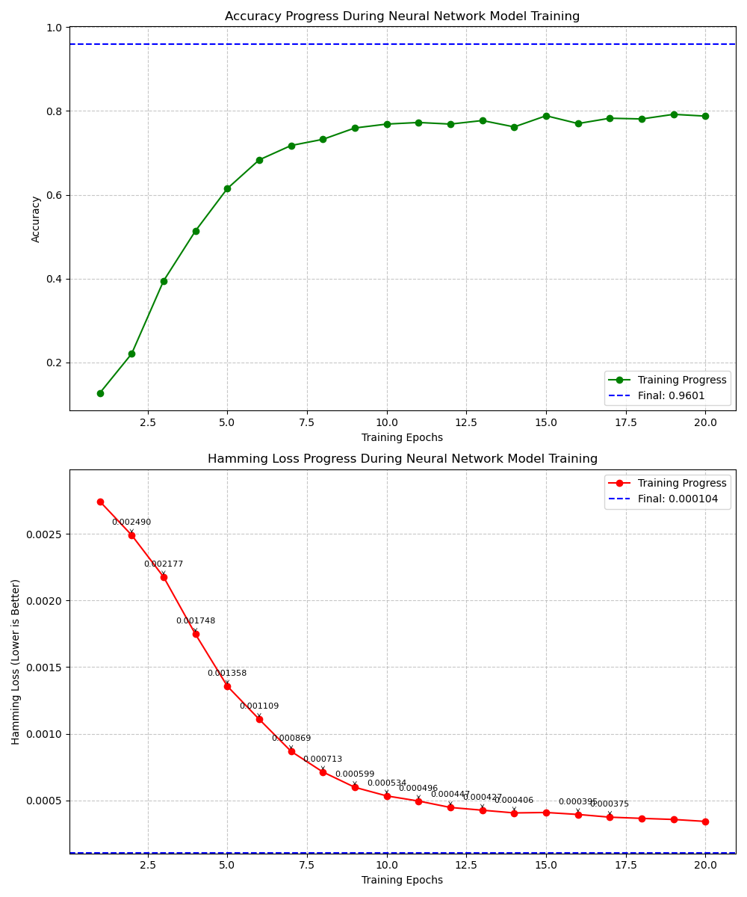
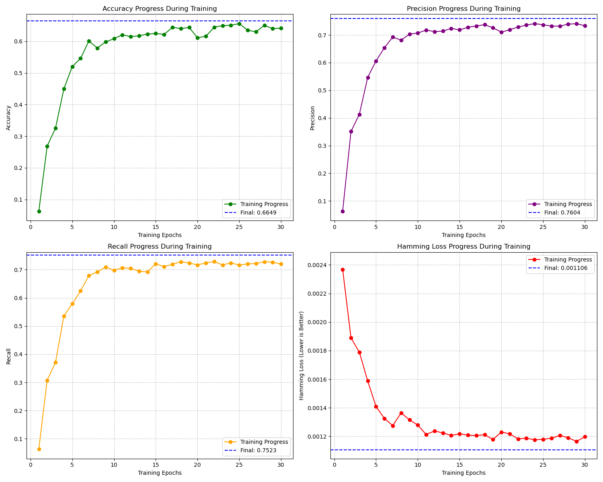
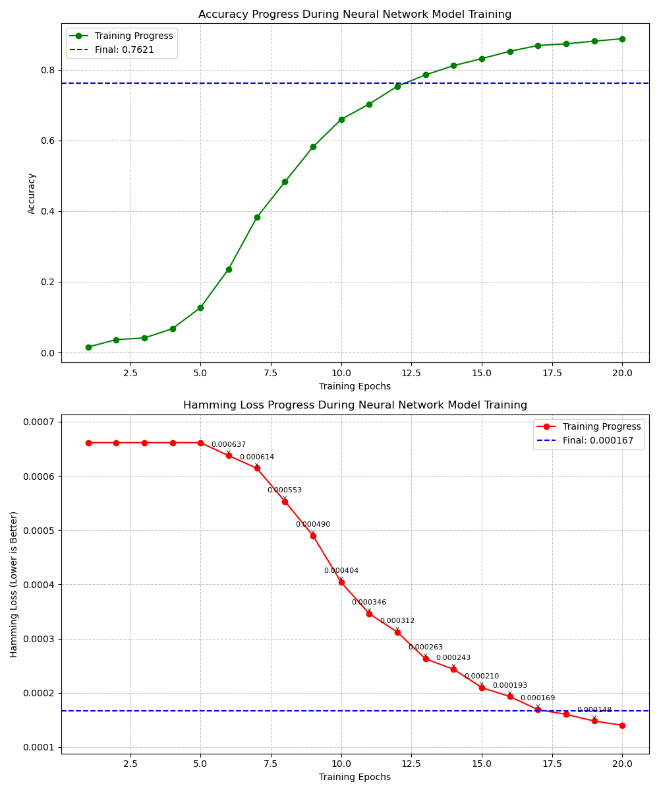
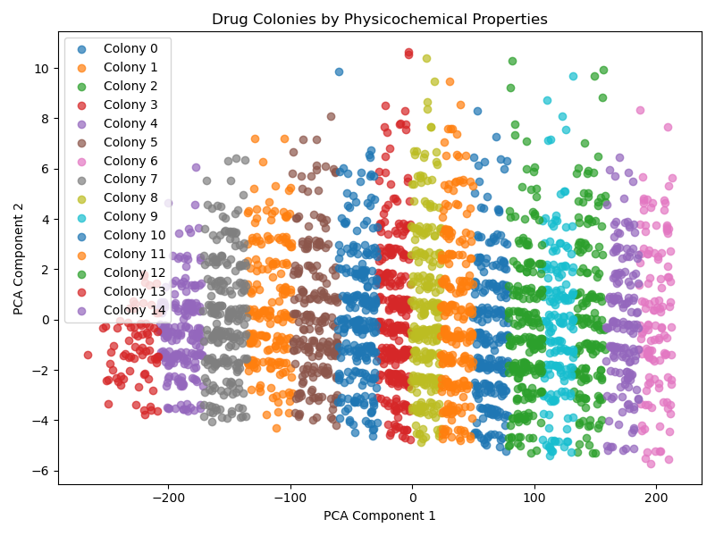
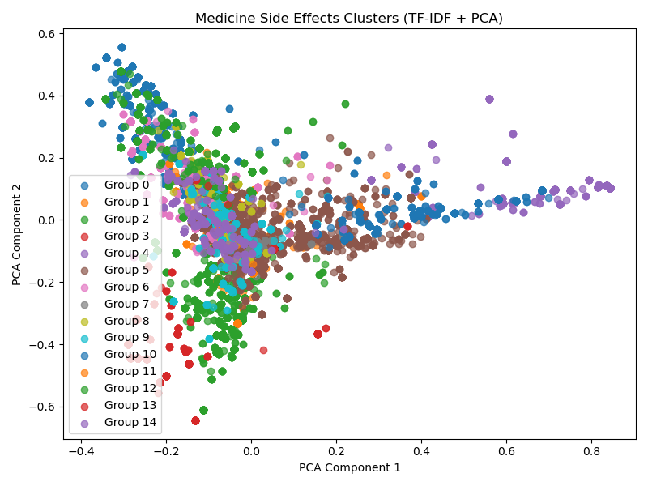
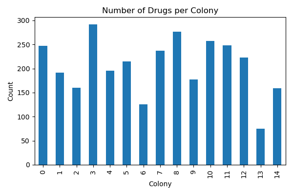
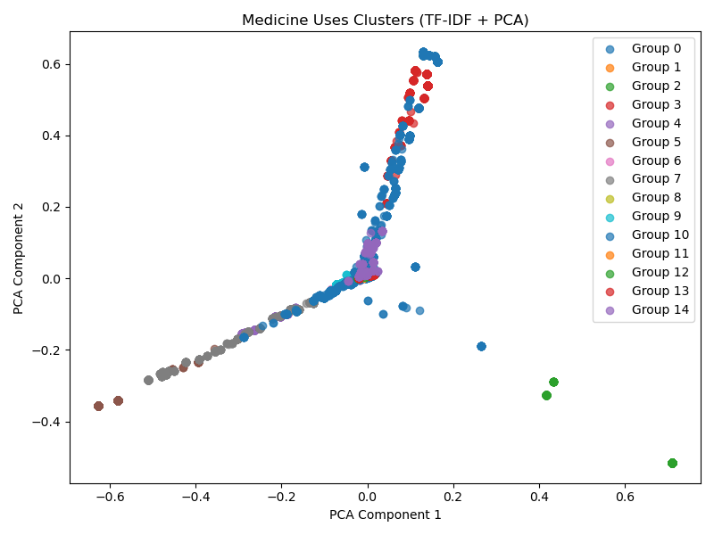

# Medicine Prediction & Drug Repurposing

## Project preview

Medicine Prediction & Drug Repurposing is a full-stack machine-learning
research application for exploring how medicines, chemical properties, and
drug-use data can support early-stage discovery workflows. It provides one
web interface for prediction, search, clustering, and model evaluation instead
of requiring users to run separate notebooks or scripts.

The project brings together three trained prediction systems:

1. **Medicine Use Predictor** — estimates likely therapeutic uses from a
   medicine name and composition.
2. **Medicine Side-Effect Predictor** — estimates possible side effects from
   medicine information and known uses.
3. **Drug Repurposing Predictor** — ranks possible new therapeutic applications
   using drug names, SMILES structures, and molecular descriptors.

Alongside prediction, the application includes fuzzy search, medicine-to-drug
relationships, molecular clustering, and evaluation pages with reusable
figures generated from the project datasets.


> **Important medical disclaimer**
>
> This is an educational and research project. Its predictions are hypotheses
> generated from historical data and machine-learning models. They are not
> medical advice, diagnoses, prescriptions, or proof of clinical effectiveness.
> Never use the application to make healthcare decisions without a qualified
> healthcare professional.

## Core capabilities

### Three machine-learning models

| Model | Inputs | Output |
|---|---|---|
| **Medicine Use Predictor** | Medicine name and composition | Candidate therapeutic uses |
| **Medicine Side-Effect Predictor** | Medicine name, composition, and uses | Candidate side effects |
| **Drug Repurposing Predictor** | Drug name, SMILES, and molecular features | Candidate alternative uses |

The serialized model artifacts are stored in [`models/`](models/), while the
model implementations and training-related code are organized under
[`src/models/`](src/models/).

### Medicine use prediction

Enter a medicine name and composition to generate possible therapeutic uses
learned from the included training data.

### Side-effect prediction

Provide medicine information and known uses to generate possible side effects.
The output is a model estimate, not a complete safety profile.

### Drug repurposing

Enter a drug, SMILES structure, and molecular features such as molecular weight,
hydrogen-bond donors, hydrogen-bond acceptors, rotatable bonds, and LogP. The
repurposing model returns possible alternative therapeutic applications.

### Search and exploration

- Fuzzy medicine and drug search
- Medicine-to-drug relationship lookup
- Side-effect search
- Molecular-property clustering
- Model evaluation pages with charts and metrics

## Results and visualizations

The repository includes evaluation figures and exploratory visualizations
produced during model development. These images are included in the project so
the results can be reviewed directly from GitHub without first running the
application.

### Model evaluation progress

The evaluation figures show training/evaluation progress for the neural-network
experiments and side-effect model:

| Medicine-use model | Drug-repurposing model |
|---|---|
|  |  |

| Side-effect model |
|---|
|  |

### Exploratory data analysis

| Drug relationships | Medicine side effects |
|---|---|
|  |  |

| Drug counts | Medicine-use groups |
|---|---|
|  |  |

Additional generated figures are available in [`results/figures/`](results/figures/)
and [`src/visualization/`](src/visualization/).

### How to interpret the results

The app displays model outputs as candidate labels or ranked predictions. A
prediction means that the model found a pattern similar to examples in its
training data; it does **not** mean that the result has been clinically
validated.

The evaluation pages expose common classification metrics:

- **Accuracy:** proportion of predictions that were correct.
- **Precision:** how often a predicted label was correct.
- **Recall:** how many relevant labels were found.
- **F1 score:** balance between precision and recall.
- **Hamming loss:** average label-wise prediction error for multi-label tasks.

The figures are development results, not clinical benchmarks. Exact outputs can
change with preprocessing, model versions, thresholds, and input data. The
repository intentionally does not present these experiments as medical
validation.

## Application architecture

```text
Browser
  |
  v
Flask application (app/app.py)
  |-- Jinja templates, CSS, JavaScript
  |-- prediction routes for three models
  |-- search, clustering, and evaluation routes
  v
Serialized models (models/)
Processed datasets (data/processed/)
  |
  v
Model outputs, charts, and exploratory results
```

## Repository structure

```text
app.py                         # Canonical launcher
app/
  app.py                       # Flask routes and application logic
  templates/                   # HTML templates
  static/                      # CSS and JavaScript
data/
  raw/                         # Original input datasets
  processed/                   # Cleaned datasets used at runtime
models/                        # Serialized trained models
results/figures/               # Evaluation charts
src/
  data/                        # Data cleaning and enhancement
  models/                      # Model implementations
  features/ and utils/         # Search and feature helpers
  visualization/               # Exploratory analysis scripts and images
requirements.txt               # Python dependencies
```

## Installation on Windows

### 1. Clone the repository

```powershell
git clone https://github.com/K4ROUI/Medicine-Prediction-Drug-Repurposing.git
cd Medicine-Prediction-Drug-Repurposing
```

### 2. Create a virtual environment

```powershell
py -3 -m venv .venv
.\.venv\Scripts\Activate.ps1
```

If PowerShell blocks activation, run the project with the environment's
interpreter directly:

```powershell
.\.venv\Scripts\python.exe -m pip install -r requirements.txt
```

### 3. Install dependencies

```powershell
python -m pip install --upgrade pip
python -m pip install -r requirements.txt
```

TensorFlow, PyTorch, and Transformers are large packages. The first install can
take several minutes and requires a stable internet connection.

### 4. Configure the Flask secret

```powershell
Copy-Item .env.example .env
```

Set a strong `FLASK_SECRET_KEY` for any shared or production deployment. Never
commit `.env` to GitHub.

### 5. Run the application

```powershell
python app.py
```

Open <http://127.0.0.1:5000/> in your browser.

The application resolves models, datasets, templates, and figures relative to
the repository root. It does not depend on the original developer's Windows
paths.

## Development and verification

Compile-check the Python source:

```powershell
python -m compileall app.py app src
```

The application can also be smoke-tested with Flask's test client. The
repository's main pages should return HTTP `200` when the included assets and
dependencies are available.

For deployment, use a production WSGI server and configure a real secret.
Flask's built-in server is intended for local development only.

## Models and data

The repository includes trained model files and processed datasets for a
reproducible demo. Some files are large. If the project exceeds GitHub's file
limits, use [Git LFS](https://git-lfs.com/) or publish models as versioned
release assets.

The raw datasets and generated files may have their own licensing or usage
requirements. Verify the original data licenses before public distribution.

## Known limitations

- Predictions depend on the quality, coverage, and preprocessing of the data.
- The application does not provide clinical validation or uncertainty
  guarantees.
- The translation model downloads on first use and may take time to initialize.
- TensorFlow and PyTorch versions should be pinned and tested for production.
- No automated test suite is included yet.

## License

No license has been selected yet. Add a license before inviting external
contributions or allowing reuse.
